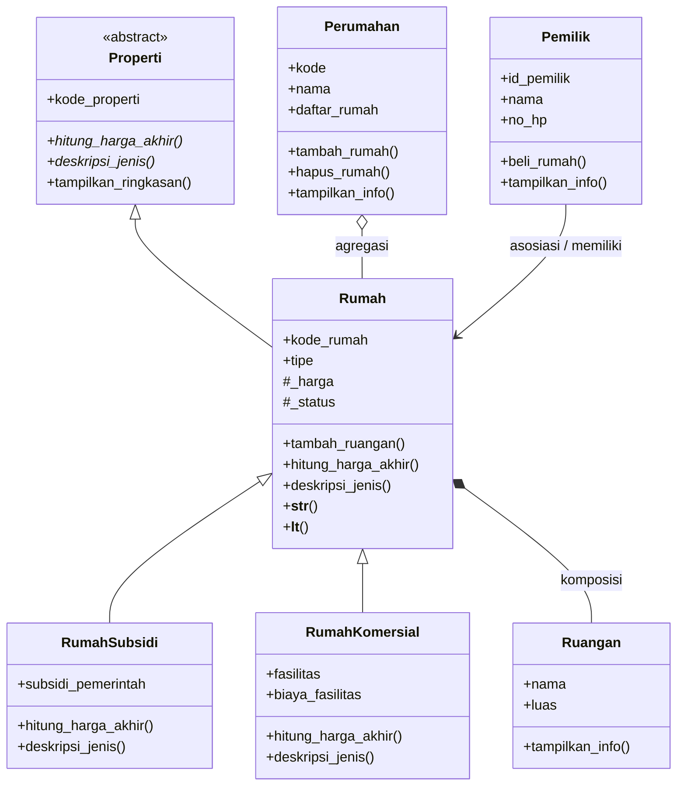

# Posttest Pemrograman Berorientasi Objek — Rae Perumahan

## 1. Deskripsi Program

**Rae Perumahan** adalah program Python sederhana untuk mengelola data perumahan, rumah, pemilik, ruangan, dan jenis rumah. Posttest ini meneruskan konsep OOP sebelumnya dan menambahkan abstraksi, polimorfisme, serta operator overloading.

## 2. Class Diagram

Diagram dibuat menggunakan Mermaid agar bisa ditampilkan langsung di README GitHub.



### Penjelasan relasi

- **Asosiasi — `Pemilik` dan `Rumah`:** `Pemilik.beli_rumah()` menghubungkan pemilik dengan rumah melalui atribut `rumah.pemilik`. Objek pemilik dan rumah dibuat secara terpisah.
- **Agregasi — `Perumahan` dan `Rumah`:** `Perumahan.tambah_rumah()` menerima objek rumah yang sudah dibuat dari luar. Rumah dapat dikeluarkan dari daftar perumahan tanpa menghapus objek rumah itu sendiri.
- **Komposisi — `Rumah` dan `Ruangan`:** `Rumah.tambah_ruangan()` membuat objek `Ruangan` lalu menyimpannya pada daftar privat rumah. Dalam model program ini, ruangan dikelola sebagai bagian dari rumah.
- **Inheritance — `Properti`, `Rumah`, `RumahSubsidi`, dan `RumahKomersial`:** `Rumah` mewarisi abstract class `Properti`, lalu kedua jenis rumah mewarisi `Rumah` dan meng-override perilaku perhitungan harga serta deskripsi jenis.

## 3. Abstraksi

`Properti` adalah abstract base class yang menggunakan `ABC` dan dua `@abstractmethod`, yaitu `hitung_harga_akhir()` dan `deskripsi_jenis()`. Method konkret `tampilkan_ringkasan()` juga tersedia agar bisa dipakai bersama oleh objek turunannya.

`Rumah`, `RumahSubsidi`, dan `RumahKomersial` menyediakan implementasi method abstrak. Subclass `RumahSubsidi` menghitung harga setelah subsidi, sedangkan `RumahKomersial` menghitung harga setelah biaya fasilitas.

Program mencoba membuat objek `Properti` secara langsung menggunakan `try-except TypeError`. Pembuatan objek tersebut ditolak karena abstract method belum diimplementasikan.

## 4. Polimorfisme

### Polimorfisme melalui pewarisan

Method `hitung_harga_akhir()` di-override pada `RumahSubsidi` dan `RumahKomersial`. Program memanggil method yang sama melalui satu loop berisi objek `Rumah`, `RumahSubsidi`, dan `RumahKomersial`, sehingga setiap objek menentukan hasilnya sendiri. Method `deskripsi_jenis()` juga memberikan deskripsi sesuai objek tanpa rantai `if/elif` untuk memeriksa tipe.

### Duck typing

Fungsi `tampilkan_informasi(objek)` memanggil `tampilkan_info()`. Fungsi yang sama digunakan untuk objek `Perumahan` dan `Pemilik`, meskipun kedua kelas tidak saling mewarisi. Fungsi hanya membutuhkan objek yang menyediakan method tersebut.

### Operator overloading

Kelas `Rumah` mengimplementasikan:
- `__str__()` agar objek rumah dapat ditampilkan dengan `str(rumah)`.
- `__lt__()` agar dua objek rumah dapat dibandingkan dengan operator `<` berdasarkan harga akhir.

## 5. Inheritance dan Enkapsulasi

`RumahSubsidi` dan `RumahKomersial` memanggil `super().__init__(...)` untuk menggunakan konstruktor superclass. Keduanya memiliki atribut unik. Atribut `_harga` dan `_status` bersifat protected berdasarkan konvensi Python, sedangkan `__harga_modal` dan `__daftar_ruangan` menggunakan name mangling untuk membatasi akses langsung.

## 6. Prinsip SOLID (Nilai Plus)

**Open/Closed Principle (OCP), secara sederhana:** perhitungan harga dapat diperluas dengan menambahkan subclass baru dari `Rumah` yang meng-override `hitung_harga_akhir()` dan `deskripsi_jenis()`. Loop pemanggilan harga tidak perlu memeriksa jenis objek dengan `if/elif`; setiap subclass menyediakan perilakunya sendiri.

## 7. Cara Menjalankan

Pastikan Python 3 sudah terpasang, lalu jalankan dari folder project:

```bash
python main.py
```

Program menggunakan modul bawaan Python (`abc`, `gc`, dan `weakref`).

## 8. Bukti Output

Jalankan `main.py`, lalu ambil screenshot terminal yang menunjukkan:
1. Bagian `ABSTRAKSI`, khususnya pesan `TypeError` saat `Properti` dicoba untuk dibuat menjadi objek.
2. Ringkasan harga dari objek `Rumah`, `RumahSubsidi`, dan `RumahKomersial`.
3. Bagian `DUCK TYPING`.
4. Bagian `OPERATOR OVERLOADING`.
5. Diagram Mermaid di bagian Class Diagram pada README.

**Catatan:** screenshot output harus diambil dari hasil menjalankan program yang sebenarnya. Mermaid akan dirender otomatis pada platform yang mendukungnya, termasuk GitHub.
