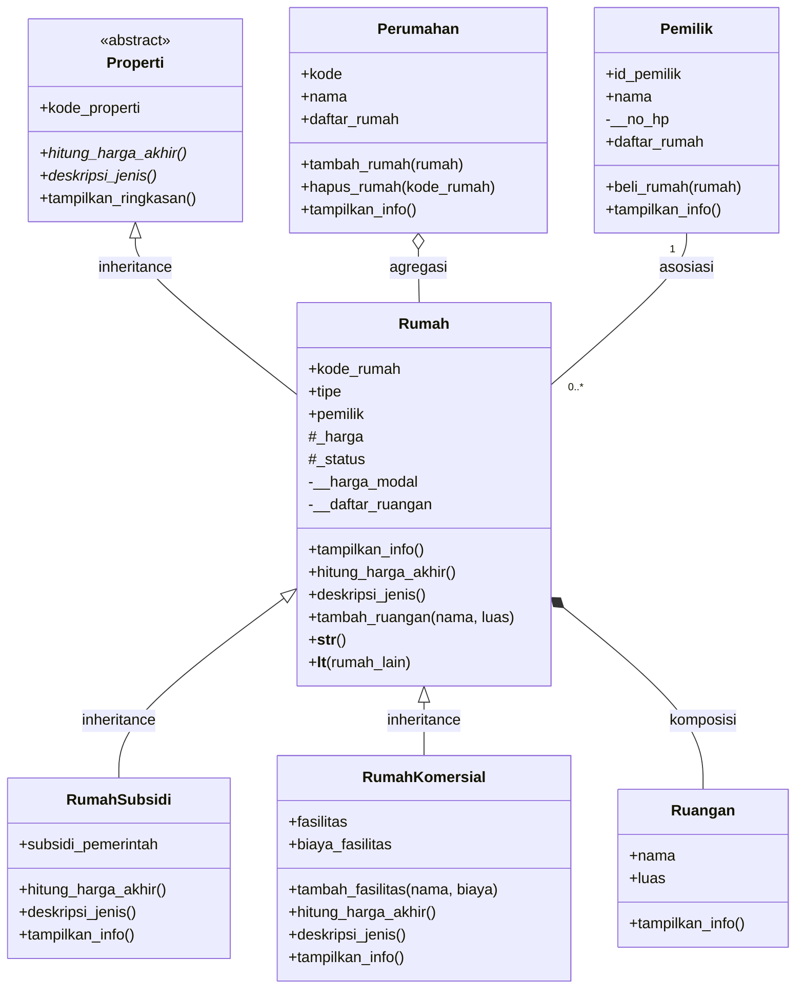
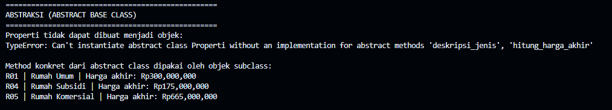
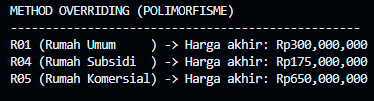
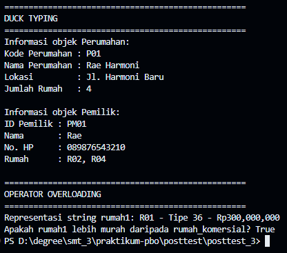

# Posttest Pemrograman Berorientasi Objek — Rae Perumahan

## 1. Deskripsi Program

**Rae Perumahan** adalah program Python sederhana untuk mengelola data perumahan, rumah, jenis rumah, ruangan, dan pemilik rumah. Program ini melanjutkan posttest sebelumnya, lalu menambahkan **abstraksi, polimorfisme, duck typing, dan operator overloading**.

## 2. Daftar Kelas

| Kelas | Peran |
|---|---|
| `Properti` | Abstract base class yang menetapkan perilaku umum properti |
| `Perumahan` | Menampung daftar rumah; berelasi agregasi dengan `Rumah` |
| `Rumah` | Subclass konkret dari `Properti`; berisi data umum rumah |
| `RumahSubsidi` | Subclass `Rumah` yang menghitung potongan subsidi |
| `RumahKomersial` | Subclass `Rumah` yang menghitung biaya fasilitas tambahan |
| `Pemilik` | Mewakili orang yang membeli rumah; berasosiasi dengan `Rumah` |
| `Ruangan` | Bagian dari rumah; dibuat dan dikelola oleh `Rumah` |

## 3. Class Diagram


Diagram menggunakan Mermaid agar dapat dirender langsung di GitHub pada `README.md`.



Keterangan visibilitas: `+` public, `#` protected, `-` private. Tanda `*` pada method abstrak menandakan method wajib diimplementasikan.

## 4. Penerapan Relasi UML

### 4.1 Asosiasi — `Pemilik` dan `Rumah`

Objek `Pemilik` dan `Rumah` dibuat secara terpisah. Ketika `Pemilik.beli_rumah(rumah)` berhasil, `Rumah.pemilik` menyimpan referensi pemilik dan `Pemilik.daftar_rumah` menyimpan rumah yang dibeli. Keduanya tetap merupakan objek mandiri.

### 4.2 Agregasi — `Perumahan` dan `Rumah`

Objek `Rumah` dibuat di luar kelas `Perumahan`, lalu dimasukkan melalui `tambah_rumah()`. Ketika rumah dikeluarkan dengan `hapus_rumah()`, objek rumah tetap ada dan dapat dimasukkan ke perumahan lain.

### 4.3 Komposisi — `Rumah` dan `Ruangan`

Objek `Ruangan` dibuat di dalam method `Rumah.tambah_ruangan()` dan disimpan dalam atribut private `__daftar_ruangan`. Dalam model program ini, daftar ruangan dikelola oleh rumah; ketika rumah sementara dihapus dan tidak ada referensi lain ke ruangannya, objek ruangan dapat dibersihkan oleh Python.

## 5. Abstraksi

`Properti` menggunakan `ABC` dan memiliki dua `@abstractmethod`, yaitu `hitung_harga_akhir()` dan `deskripsi_jenis()`. Method konkret `tampilkan_ringkasan()` digunakan bersama oleh objek turunannya. `Rumah` menyediakan implementasi umum, sedangkan `RumahSubsidi` dan `RumahKomersial` mengubah perilaku perhitungan harga dan deskripsi jenis.

Program juga mencoba membuat objek `Properti` secara langsung menggunakan `try-except TypeError`. Pembuatan objek ditolak karena abstract method belum diimplementasikan.

## 6. Polimorfisme

### 6.1 Polimorfisme melalui pewarisan

Method `hitung_harga_akhir()` di-override oleh `RumahSubsidi` dan `RumahKomersial`. Method yang sama dipanggil melalui satu loop berisi objek `Rumah`, `RumahSubsidi`, dan `RumahKomersial`. Setiap objek memberikan hasil sesuai perilakunya sendiri, tanpa rantai `if/elif` untuk menentukan jenis rumah.

### 6.2 Duck typing

Fungsi `tampilkan_informasi(objek)` memanggil method `tampilkan_info()`. Fungsi yang sama digunakan untuk objek `Perumahan` dan `Pemilik`. Kedua kelas tidak saling mewarisi, tetapi keduanya memiliki method dengan nama yang sama.

### 6.3 Operator overloading

- `Rumah.__str__()` mengatur tampilan objek saat dipanggil dengan `str(rumah)`.
- `Rumah.__lt__()` memungkinkan dua objek rumah dibandingkan menggunakan operator `<` berdasarkan harga akhir.

## 7. Inheritance dan Enkapsulasi

`RumahSubsidi` dan `RumahKomersial` memanggil `super().__init__(...)` untuk menggunakan konstruktor kelas induk. Atribut khusus `RumahSubsidi` adalah `subsidi_pemerintah`, sedangkan `RumahKomersial` memiliki `fasilitas` dan `biaya_fasilitas`.

Atribut `_harga` dan `_status` menggunakan konvensi protected Python. Atribut `__harga_modal` dan `__daftar_ruangan` menggunakan name mangling untuk membatasi akses langsung.

## 8. Prinsip SOLID (Nilai Plus)

**Open/Closed Principle (OCP):** jenis rumah baru dapat ditambahkan sebagai subclass `Rumah` dengan mengimplementasikan perilaku harga dan deskripsi yang sesuai. Loop polimorfisme tidak perlu diubah menjadi rangkaian pemeriksaan tipe.

## 9. Hasil Output Program

Output berikut berasal dari eksekusi `python main.py`. Bagian ini menjadi referensi hasil program; untuk memenuhi ketentuan screenshot, jalankan program di terminal komputer sendiri dan ambil screenshot dari bagian-bagian berikut.

<details>
<summary><b>Abstraksi dan method konkret</b></summary>

```text
ABSTRAKSI (ABSTRACT BASE CLASS)
==================================================
Properti tidak dapat dibuat menjadi objek:
TypeError: Can't instantiate abstract class Properti without an implementation for abstract methods 'deskripsi_jenis', 'hitung_harga_akhir'

Method konkret dari abstract class dipakai oleh objek subclass:
R01 | Rumah Umum | Harga akhir: Rp300,000,000
R04 | Rumah Subsidi | Harga akhir: Rp175,000,000
R05 | Rumah Komersial | Harga akhir: Rp665,000,000
```

</details>

<details>
<summary><b>Polimorfisme melalui pewarisan</b></summary>

```text
METHOD OVERRIDING (POLIMORFISME)
--------------------------------------------------
R01 (Rumah Umum     ) -> Harga akhir: Rp300,000,000
R04 (Rumah Subsidi  ) -> Harga akhir: Rp175,000,000
R05 (Rumah Komersial) -> Harga akhir: Rp665,000,000
```

</details>

<details>
<summary><b>Duck typing</b></summary>

```text
DUCK TYPING
==================================================
Informasi objek Perumahan:
Kode Perumahan : P01
Nama Perumahan : Rae Harmoni
Lokasi         : Jl. Harmoni Baru
Jumlah Rumah   : 4

Informasi objek Pemilik:
ID Pemilik : PM01
Nama       : Rae
No. HP     : 089876543210
Rumah      : R02, R04
```

</details>

<details>
<summary><b>Operator overloading</b></summary>

```text
OPERATOR OVERLOADING
==================================================
Representasi string rumah1: R01 - Tipe 36 - Rp300,000,000
Apakah rumah1 lebih murah daripada rumah_komersial? True
```

</details>

<details>
<summary><b>Relasi UML — agregasi, asosiasi, dan komposisi</b></summary>

```text
AGREGASI: PERUMAHAN o-- RUMAH
Rumah R03 dikeluarkan dari Rae Harmoni.
Objek rumah R03 masih ada setelah dikeluarkan:
Kode : R03 | Tipe : 50
Rumah R03 masih bisa dimasukkan ke perumahan lain:
Rumah R03 masuk ke Rae Sejahtera.

ASOSIASI: PEMILIK -- RUMAH
Rae berhasil membeli rumah R02.
Rae berhasil membeli rumah R04.
Rumah R02 tidak tersedia untuk dibeli!
Budi berhasil membeli rumah R05.

KOMPOSISI: RUMAH *-- RUANGAN
Total luas ruangan R05 : 45 m2
Total objek Ruangan    : 3
Total objek Ruangan sebelum dihapus : 4
Ruangan masih ada                   : True
Total objek Ruangan setelah dihapus : 3
Ruangan masih ada                   : False
```

</details>

### Screenshot yang perlu dimasukkan







## 10. Cara Menjalankan

Pastikan Python 3 terpasang, lalu jalankan dari folder project:

```bash
python main.py
```

Program hanya menggunakan modul bawaan Python: `abc`, `gc`, dan `weakref`.

## 11. Kesimpulan

Program Rae Perumahan mempertahankan relasi asosiasi, agregasi, dan komposisi serta inheritance dari posttest sebelumnya. Posttest lanjutan menambahkan abstract class, method overriding, duck typing, dan operator overloading. Method yang sama dapat menghasilkan perilaku berbeda sesuai objek yang menjalankannya.
